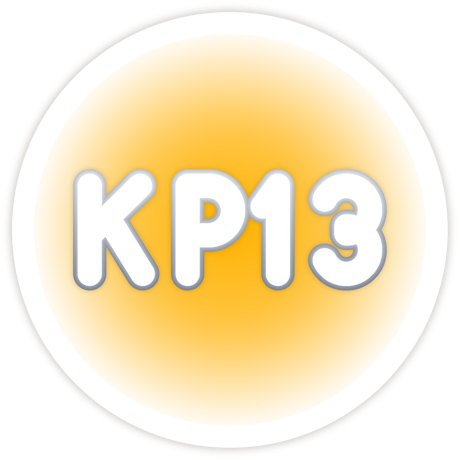

# ✦ KairoPhos ✦
*καιρός + φῶς — a small light, at the right time*

`[ status: tuning an ocarina 🎶 ]` `[ mood: cozy ]` `[ instance: friends+ ]`

---

### ⟡ about.exe
hi! (｡•̀ᴗ-)✧ I make **kan!**, a free rhythm game you play with a *real*
instrument. the goal is simple: practice should feel like play, and what
you learn should go home with you — to your friends, your family, your
community's songs.

### ⟡ things I like
- 🎶 melodies older than all of us
- 🫖 tea, long builds, and the moment a test finally turns green
- 🪵 campfire energy: everyone gets a turn, nobody gets left out
- ✨ clean code, kind reviews, and the friend who teaches you the chord

### ⟡ instance rules
1. **your win is my win.** clap loudly.
2. **practice > perfection.** wrong notes are just notes on their way.
3. **share the stage.** the best solo is the one that invites a duet.
4. **leave every lobby warmer than you found it.**
5. lost? there's always a seat by the fire. pull up. 🔥

### ⟡ currently building
- [kan!](https://github.com/KairoPhos13/kan-rhythm) — play real instruments, calmly
- issues tagged `good first issue` are open doors, come in ✦

*made with good timing and good love* ♡

